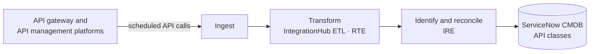

## Hi, I'm Jaimin

I'm a software engineer at **Crest Data** in Ahmedabad. I build API and data integrations: connectors that bring API inventory and usage data from API gateway platforms into the ServiceNow CMDB, cleaned up and ready for other teams to rely on.

Below is my path so far, most recent first.

---

### Crest Data · Software Engineer
**Jan 2024 – now · Ahmedabad**

Most of my work is on API Service Graph Connectors. Large companies often run their APIs across several API gateway and API management platforms, and each one describes an API in its own way. A connector pulls that data in on a schedule, cleans it up, works out which records belong together, and loads it into the CMDB. That lets teams answer simple questions that are surprisingly hard otherwise: which APIs do we have, how much are they used, and what depends on what.

> [!NOTE]
> The code is closed source, but the products are public. The connectors I build and maintain are part of ServiceNow's **[API Service Graph Connectors](https://www.servicenow.com/docs/r/zurich/servicenow-platform/configuration-management-database-cmdb/api-sgc-available.html)** portfolio, which brings API data from API gateway and API management platforms into the CMDB.

What I work on day to day:

- **10+ connectors, end to end.** Requirements, data mapping, build, testing, documentation, ServiceNow Store certification, release, and the customer cases that come in afterwards.
- **Inventory and usage data.** APIs, proxies, endpoints, gateways and consumer access, plus API call metrics so teams can see which APIs carry real traffic and which have gone quiet.
- **Identification and reconciliation.** Identifying each incoming record and reconciling it against what is already in the CMDB, so each API shows up once, linked to the right gateway and endpoints, instead of piling up as duplicates.
- **Performance at volume.** Runs range from 100K to 6M records, so I spend a fair amount of time tuning API calls, data loads, transforms and queries.
- **Testing before every release.** JUnit integration and performance tests and Playwright automation, running in Jenkins and GitHub Actions.

The biggest lesson so far: moving data is the easy part. Making it correct on every run, at volume, is where the real work is, and that depends on a solid foundation underneath. ServiceNow provides that foundation: the CMDB data model, a transform layer (IntegrationHub ETL and RTE), and an identification and reconciliation engine (IRE). Every Service Graph Connector is built on top of it. So supporting a new platform means building a new connector that focuses on that platform's data and entities and maps them to CMDB entities, without reworking the platform underneath. Getting that same behaviour from custom software alone would be close to impossible.

**ServiceNow certifications:** the three that matter most for building Service Graph Connectors and working with the CMDB, IRE and Data Foundations.

- [Certified Implementation Specialist – Data Foundations (CMDB and CSDM)](https://www.credly.com/badges/36a41875-de1c-44e6-b2ee-349433064d44) · CIS-DF
- [Certified Application Developer](https://www.credly.com/badges/4982f3c1-2302-4bc3-a22e-d59cfc076999) · CAD
- [Certified System Administrator](https://www.credly.com/badges/9c51a5cc-c8c1-47f3-84f8-7a93b7c5482f) · CSA

**Core skills:** `JavaScript` &nbsp; `Java` &nbsp; `REST APIs` &nbsp; `ETL` &nbsp; `IntegrationHub ETL` &nbsp; `IRE` &nbsp; `RTE` &nbsp; `CMDB` &nbsp; `Flow Designer` &nbsp; `Scripted REST APIs` &nbsp; `JUnit` &nbsp; `Playwright` &nbsp; `ATF` &nbsp; `Jenkins` &nbsp; `GitHub Actions` &nbsp; `Claude` &nbsp; `Devin`

---

### Upeya · Software Engineer Intern
**Apr 2023 – Jul 2023 · Gandhinagar (Remote)**

My first real backend job. I was the only backend engineer on a women's health tracking and management app, and I owned the backend from the first endpoint to production, including full AWS access to set up and deploy both the backend and database servers.

It was also my first time working closely with frontend engineers, one building the iOS app and one building the Android app. I learned a lot about designing APIs that mobile apps can actually build against, and about keeping separate test and production environments healthy.

- **37 app screens and flows.** OTP login, token-based auth, password recovery, health and symptom tracking, and daily insights.
- **10+ backend modules.** Authentication, symptom tracking, notifications, content delivery, and nearby-hospital discovery using location services.
- **Test and production on AWS.** Deployed and maintained the backend and database servers on EC2, with S3 for storage, SES for email and SNS for notifications, running behind Nginx and PM2.
- **Documentation.** API docs and notes on key design decisions for the team.

Being the only backend engineer taught me to care about structure early. The way I organise a Node.js project today came out of this internship, and I turned it into a template:

- [nodejs-backend](https://github.com/jaimin1618/nodejs-backend): Express and MongoDB project structure with JWT auth and request validation (16 forks)

**Core skills:** `Node.js` &nbsp; `Express.js` &nbsp; `MongoDB` &nbsp; `Redis` &nbsp; `REST API design` &nbsp; `JWT auth` &nbsp; `AWS EC2` &nbsp; `S3` &nbsp; `SES` &nbsp; `SNS` &nbsp; `Nginx` &nbsp; `PM2`

---

### ABU Robocon · LDCE team
**2021 – 2023**

One of 19 students who built two robots for DD-Robocon 2022 and made it to the national contest at IIT Delhi. I built the IoT app used to control the robots, and worked on communication between microcontrollers and on computer vision.

- [three-omni-wheel-vehicle-control](https://github.com/jaimin1618/three-omni-wheel-vehicle-control): holonomic drive with PID control, driven from a PS3 controller or an Android app
- [embedded-programming](https://github.com/jaimin1618/embedded-programming): Arduino and Atmel microcontrollers

**Core skills:** `C++` &nbsp; `Arduino` &nbsp; `ESP8266` &nbsp; `MPU6050` &nbsp; `PID control` &nbsp; `MIT App Inventor`

---

### L.D. College of Engineering · B.Tech, Information Technology
**2020 – 2024 · Ahmedabad**

Where I learned by building. HTML and CSS first, then C++ and data structures, then PHP backends, then React, and blockchain projects in the last two years. Along the way, our team won first prize at the SSIP Hackathon (Revenue Department challenge) and reached the grand finale of Kavach 2023, a national cybersecurity hackathon.

- [DSA-library](https://github.com/jaimin1618/DSA-library) · [data_structures_and_algorithms](https://github.com/jaimin1618/data_structures_and_algorithms): C++ foundations, and 540+ problems on LeetCode
- [php-rest-api-template](https://github.com/jaimin1618/php-rest-api-template) · [ldce-grievance](https://github.com/jaimin1618/ldce-grievance): first backends, MVC and REST
- [contact-management-app](https://github.com/jaimin1618/contact-management-app): React and Redux Toolkit
- SiddhiCred, a blockchain credential platform: [frontend](https://github.com/jaimin1618/siddhicred-frontend) · [backend](https://github.com/jaimin1618/siddhicred-backend) · [smart contract](https://github.com/jaimin1618/siddhicred-smart-contract)
- [doconsent_dapp](https://github.com/jaimin1618/doconsent_dapp): React dApp with IPFS storage

**Core skills:** `C++` &nbsp; `Data structures & algorithms` &nbsp; `PHP` &nbsp; `Laravel` &nbsp; `MVC` &nbsp; `React` &nbsp; `Redux Toolkit` &nbsp; `Solidity` &nbsp; `Ethereum` &nbsp; `IPFS`

---

[LinkedIn](https://www.linkedin.com/in/jaimin1618) · [LeetCode](https://leetcode.com/u/cipher1618/)
